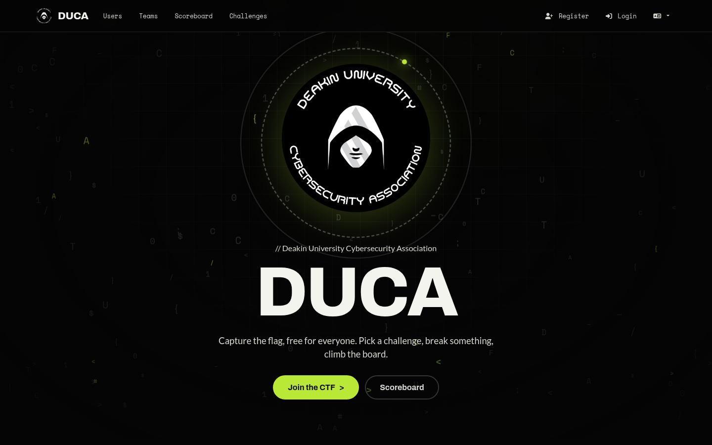
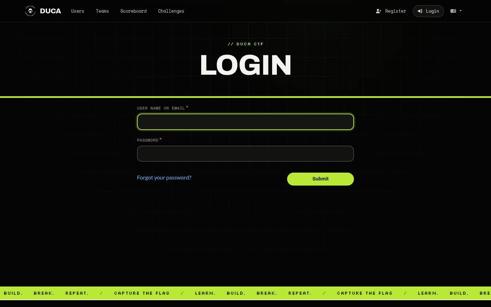
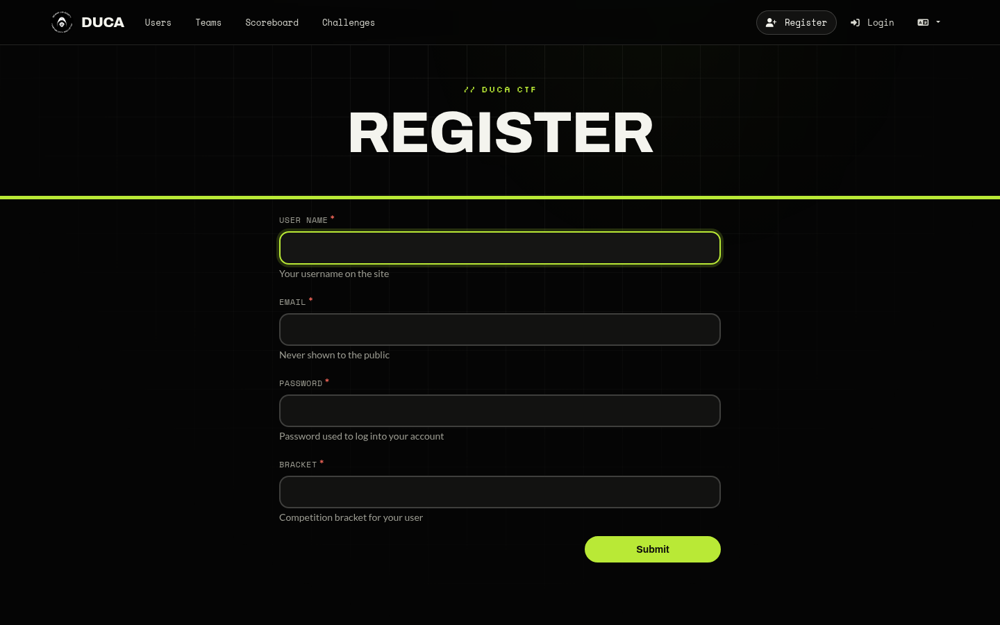
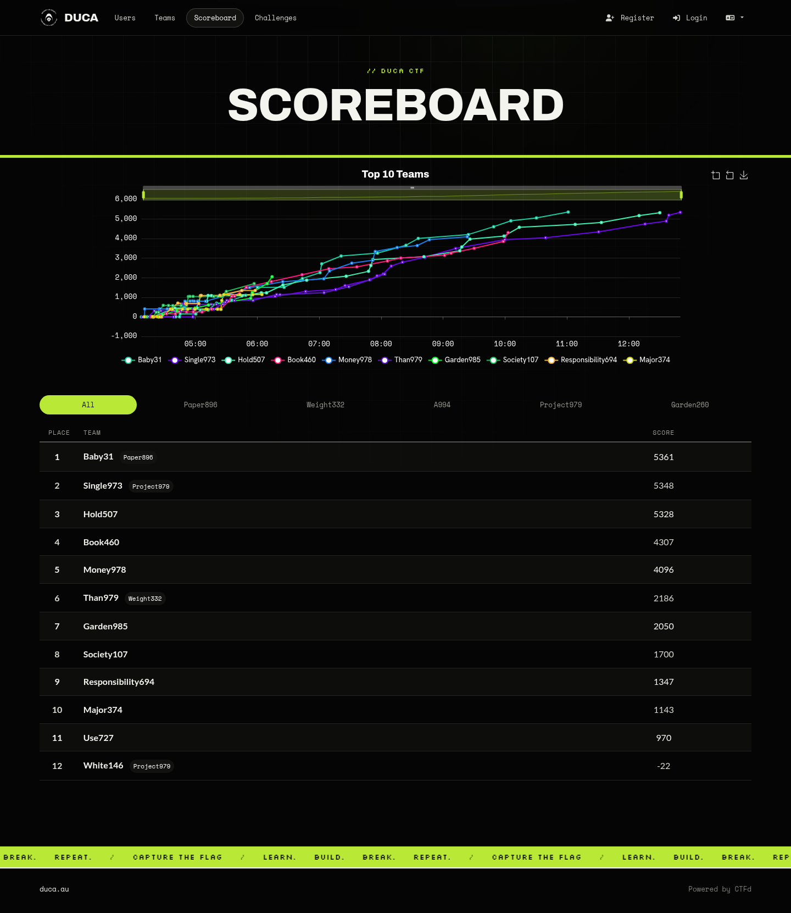
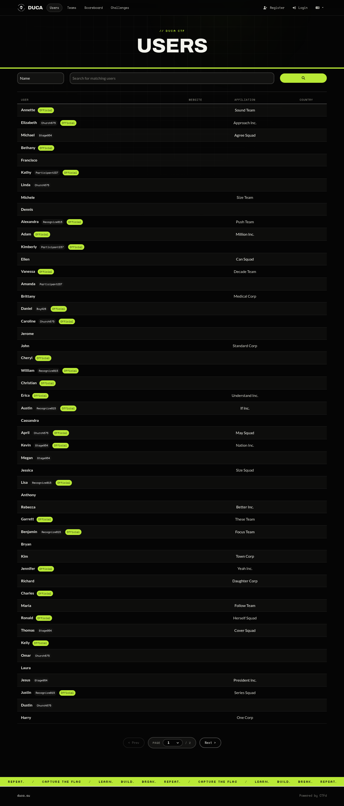
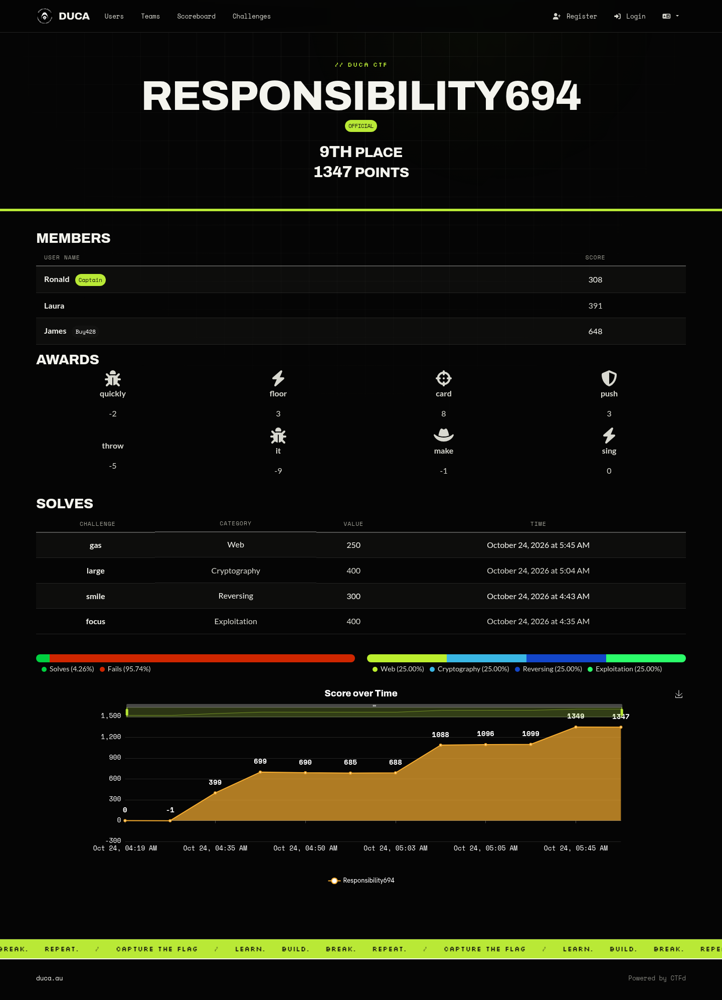
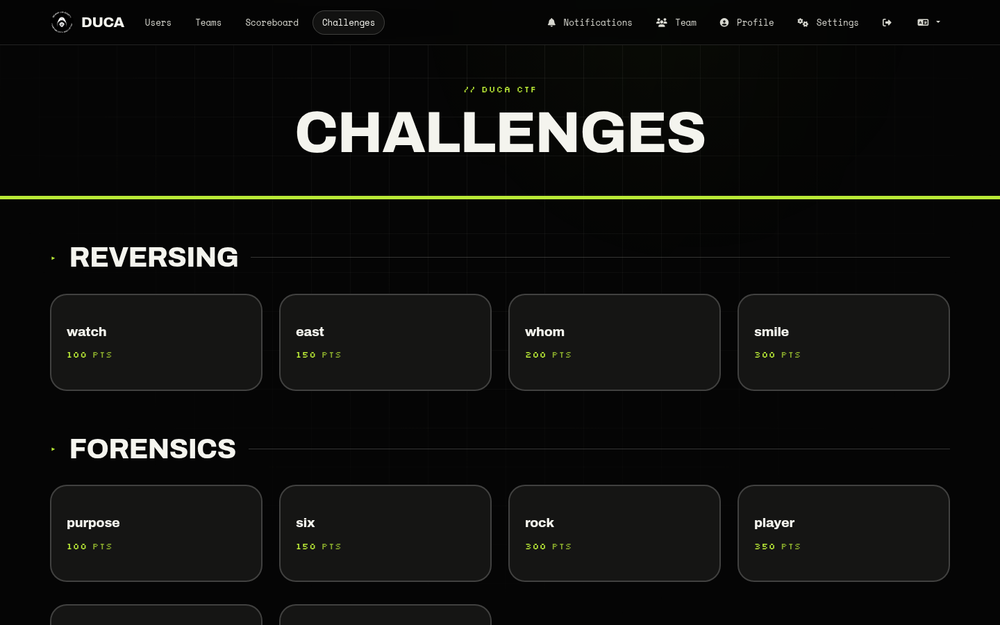
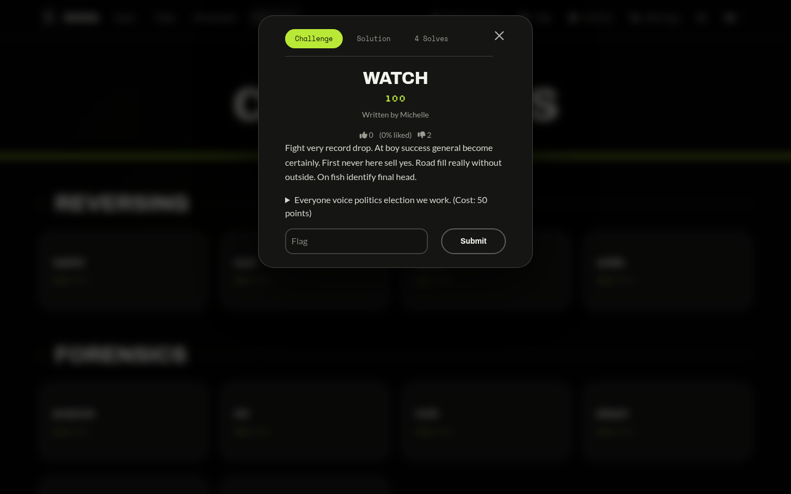
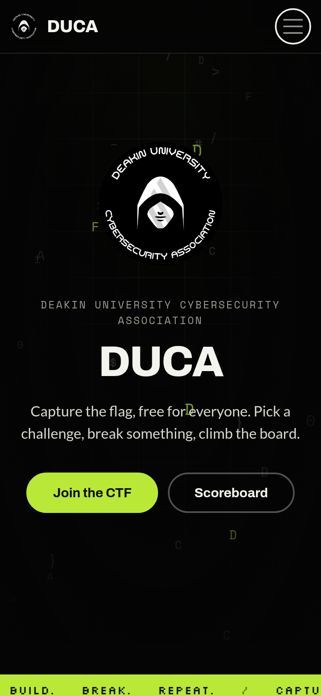

# Showcase

Screenshots of the DUCA theme running against the demo dataset (`testing/seed-data/duca-demo.zip`), 1440px wide (the phone shot is 390px at 2x).

## Landing page

Landing page. The DUCA logo, drifting code characters that scatter away from the cursor, and magnetic buttons.



## Login

Login.



## Register

Register.



## Scoreboard

Scoreboard with the Top 10 chart, bracket filters and the standings table.



## Users

Users list.



## Team profile

Team profile with the score-over-time chart, awards and solves.



## Challenges

Challenge board, logged in as the demo player.



## Challenge modal

An open challenge: tabs, hints and flag submission.



## Pagination

Pagination control.


## Landing (mobile)

Landing page on a phone.



## Regenerating

Start the test stack and load the dataset (`docker compose up -d && ./scripts/seed.sh` in [../testing](../testing)), then:

```bash
python -m venv .venv
.venv/bin/pip install playwright
.venv/bin/python showcase/capture.py
```

The script logs in as the seeded `demo` player. It uses the Chromium on your `PATH`; set `CHROMIUM=/path/to/chromium` to pick another, or run `.venv/bin/playwright install chromium` and unset it. Point it at a different instance with `CTFD_URL=http://127.0.0.1:8002`.

The dataset is fixed, so re-running produces the same teams and scores.
